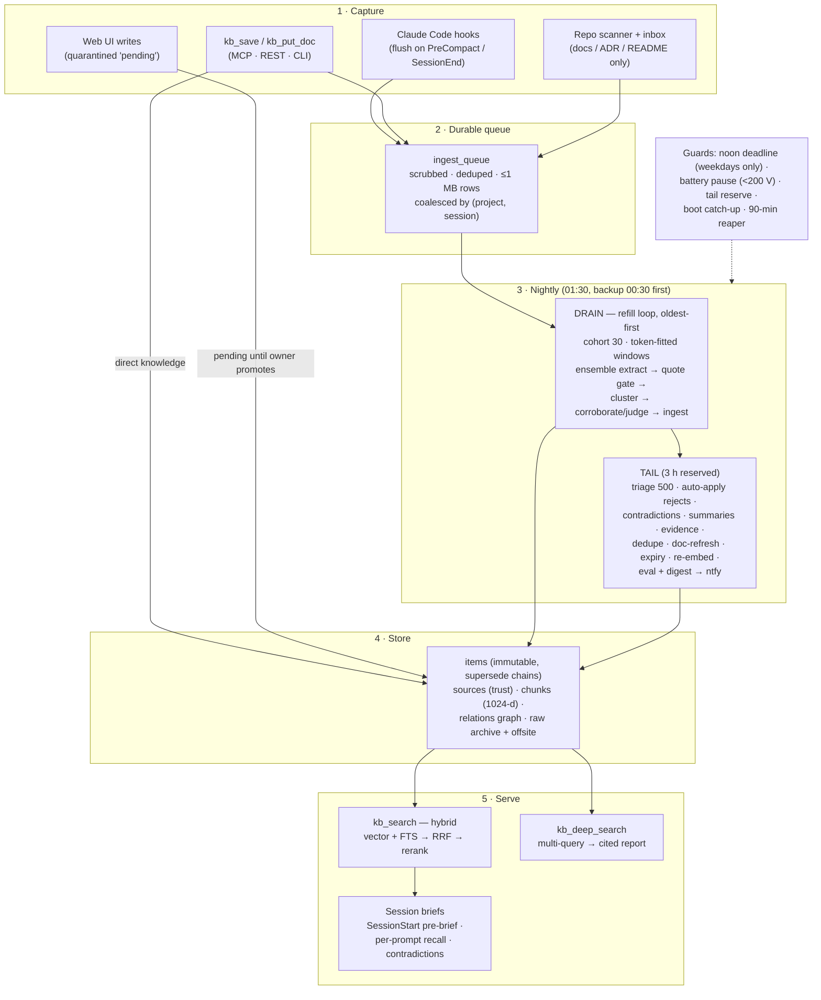
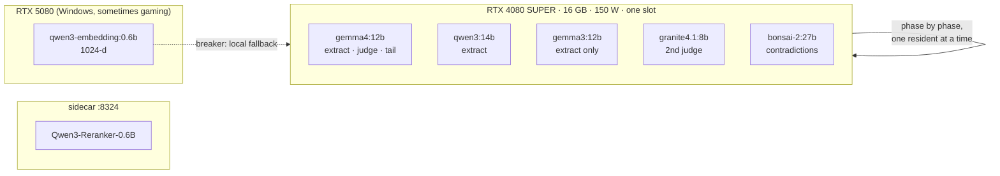

# Data flow — capture to briefs

How knowledge moves through the Vault. Short version; the code comments carry the depth.

## The big picture

## 1 · Capture

Every session on every machine flushes its transcript before compaction and at
session end. Transport order: **LOCAL** enqueue → **MCP** → **CONNECTOR** →
**REST** (900 KB chunks, resumable offsets). Per-project tokens are auto-minted
on the owner box; remote boxes enrol once with a one-shot `kbe_` code. Secrets
are scrubbed **before** storage; raw text with secrets is never persisted.

Other doors: `kb_save` (direct knowledge, typed + tagged), `kb_put_doc` (raw
documents, archived + anchorable via `raw_ref`), the web UI (writes land
quarantined until the owner promotes), and the repo scanner (docs only — the KB
is not a code index).

## 2 · Queue

One durable table. Rows are deduped by content hash, capped at 1 MB, and
coalesced per `(project, session)` after a quiet period — so one session becomes
one job, never a cross-project blend.

## 3 · Nightly

**Drain** (GPU-heavy, first): refills cohort-by-cohort, oldest first. Each
session is split into token-fitted windows (~7 k tokens — Ollama truncates at
`num_ctx/2`, so windows are *measured*, not estimated). Three extractors run
**model-major** (each model loads once per cohort — 0.017 loads/call measured).
Extracted items must quote the transcript verbatim (fuzzy repair ≥ 0.95) or are
rejected. Cross-model clusters corroborate; singletons face a judge. Survivors
ingest as `unverified` + a review row.

**Tail** (reserved 3 h): triage suggests keep/reject per row (500/night);
**reject suggestions auto-apply** after a 3-day cooling window (accessed items
excluded; duplicates only within one project and never across a pair the
cross-project twin linker already joined; cluster-winner closes share the same
cap; everything undoable); contradiction pairs are judged with a
per-pair memory (never re-pay a verdict); stable suggestions auto-resolve at
streak 2; summaries, evidence, dedupe, doc-refresh supersede, 30-day quiet
expiry (capped at 500/night, oldest first; untriaged and reject-suggested rows
never expire, and the batch is undoable), re-embed, then the eval sentinel and a
one-line **ntfy digest** to the owner.

**Guards**: hard noon deadline on weekdays (weekends run unbounded), battery
pause when grid < 200 V (any dip in last 5 readings), tail reserve, boot
catch-up after power loss, 90-min liveness reaper. Stopping anywhere is safe:
rows stay `pending`; the queue **is** the checkpoint.

## 4 · Store

Items are immutable — corrections go through `supersede()`, automation only
flips `status`, nothing is ever deleted (that rule recovered 114 MB once). Trust
lives on sources: `verified` (human) vs `unverified` (machine). Raw transcripts
and documents are archived on disk and pushed offsite nightly (age-encrypted),
so any extraction can be re-run by a better pipeline later.

## 5 · Serve

`kb_search`: vector leg (HNSW, `iterative_scan`) + full-text leg, fused with
RRF, reranked by the sidecar (fed best-chunk evidence). Trust breaks ties.
Graph expansion and `as_of` (valid-time) are opt-in. `kb_deep_search` plans
sub-queries and synthesizes a cited report on the local model.

Briefs close the loop: **SessionStart** injects top matches for recent git
activity plus any open contradictions for that project; **every prompt** gets
lightweight recall; **Stop** pushes a completion notification. Machines check a
content-derived manifest version each session and announce when their hooks are
stale.

## Models

| Role | Model | Size / VRAM | Where | Notes |
|---|---|---|---|---|
| Extractor (primary) | `gemma4:12b` | 12 B · ~9.6 GB (+MTP draft) | local RTX 4080 S | primary since 2026-10-26 (union member from 2026-10-25, replacing `granite4.1:8b`; refreshed 2026-09-27 weights). Bench: 33 kept facts @ 0.70 vs qwen3 26 @ 0.50; first production night, blind panel: gemma4-only items kept 0.75 vs qwen3-only 0.41; role benches before the swap: triage, summaries better than qwen3, factored and same-fact judging equal and 2× faster (KB 55032 + the swap decision); `num_ctx` 16384, pinned seed |
| Extractor (ensemble) | `qwen3:14b` | 14 B · ~11.7 GB | local | primary until 2026-10-26, kept as a union member so its facts stay in (it uniquely adds ~1 kept fact/window) |
| Extractor (ensemble) | `gemma3:12b` | 12 B · ~8 GB | local | union member only — failed the judge bench both directions, never judges |
| Secondary judge | `granite4.1:8b` | 8 B · ~5 GB | local | judges primary singletons (probe bench: 7/7 real kept, 6/6 fakes caught); no longer an extractor |
| Judge (factored) | `gemma4:12b` | (same) | local | the primary verifies non-primary singletons; fail-closed |
| Contradiction judge + precision gate | `bonsai-2:27b` | 27 B ternary · ~8.9 GB | local | `KB_CONTRADICTION_JUDGE_MODEL` (2026-10-25): on the 92 auto-resolved pairs vs a blind ground truth precision 0.78 vs qwen3's 0.52; `KB_AUTO_RESOLVE_JUDGE_GATE` re-judges (strict three-state) before any evidence auto-retire — no conflict holds the row for the owner |
| Triage / summaries / same-fact twins / evidence / deep search | `gemma4:12b` | (same) | local | follow `KB_EXTRACT_MODEL`; tail steps capped per night; summaries are fitted to the prompt ceiling first (KB 55031) |
| Embedder | `qwen3-embedding:0.6b` | 0.6 B · ~2.4 GB | **remote RTX 5080** (local fallback + 90 s breaker) | 1024-d; **query prefix required** (hit@5 0.759 vs 0.724 without) |
| Reranker | `Qwen3-Reranker-0.6B` | 0.6 B GGUF | sidecar (llama-server :8324) | official GGUF only — community conversions score garbage; chunk-evidence fed (hit@5 0.86 → 0.89); host-RAM prompt cache OFF (`LLAMA_ARG_CACHE_RAM=0` drop-in, 2026-10-11: RSS 9.4 GB → 1.8 GB, scores bit-identical after warm-up); runs a **pinned** llama-server copy (`/opt/kb-rerank/llama-0.31.1`, 2026-10-25) so Ollama upgrades never touch it — units in `deploy/system/` |
| Window budgeter | `cl100k` (tiktoken, vendored) | — | in-process, offline | counts tokens for window fitting; 1.15× margin covers the qwen-tokenizer mismatch |

GPU rules: **one model slot** (`OLLAMA_MAX_LOADED_MODELS=1`), finite keep-alive
(600 s — never `-1`), 150 W power cap (UPS), model-major cohorts so each load
serves ~58 calls. Embeddings live on the second box so the local slot never
thrashes against a 0.6 B model. Local Ollama is **0.40.11** (2026-10-25, from
0.31.1; manual tarball install, rollback copy and runbook in
`deploy/system/README.md`).

